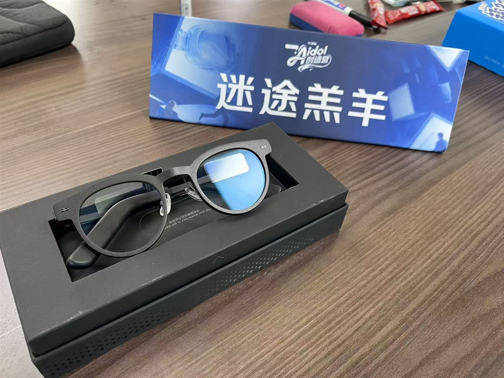
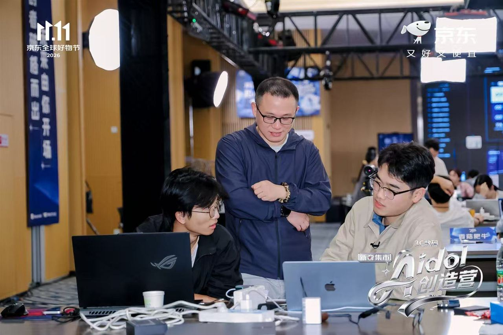

# 问全 · 实时访谈助手（Qall）

> 京东黑客松 · AI 眼镜赛道作品。眼镜 + 手机双端访谈助手：认真听回答的同时抓住值得追问的细节，访谈后整理**每条要点带原话出处**的素材。

| AI 眼镜样机（迷途羔羊队） | 京东 AIdol 创造营现场 |
|---|---|
|  |  |

## 📊 当前版本与完成度

**V0.6.0（2026-10-18，本地开发预览）**，分支 `feat/0.6.0-voice-identity`。

| 模块 | 状态 |
|---|---|
| 主持人预录、嘉宾现场依次单人建档 | ✅ 已接通 sherpa-onnx 1.13.8 + 中文 WeSpeaker ResNet34 真实 CPU 模型 |
| 声音身份：注册 / 同人换文字匹配 / 不同声音建档 / 跨流匹配 / Ogg-Opus 解码清理 | ✅ 7 项本机检查通过 |
| 完整自动回归 | ✅ 148/148 通过 |
| 手机实际录音、真实六人场景、阈值校准 | ⚠️ 未验收 |
| 眼镜端到端延迟、线上后端部署 | ⚠️ 未完成，当前仅回环本地预览 |

> Studio 工作区为独立本地预览目录（含 PhoneSDK 与 GlassSDK）。模型与加密配置位于被忽略的 `.env.voice.local`，勿提交；仅 Studio 预览包允许使用回环后端，不能扫码装到手机后当作线上服务。

## 🎤 产品能力

1. **提纲引导**：确认提纲后眼镜显示可选主线问题；收到回答后优先展示有依据的追问或转场，主问题已回应且暂无候选时补下一条主线建议；无新语音时保留建议，不因沉默自动跳题。
2. **角色判断**：流式 ASR 与模型结合语境判断主持人 / 嘉宾，不确定片段保留待识别，完整转写支持人工更正。
3. **会后归纳**：按主线整理核心内容与待补问，要点带嘉宾原话出处，章节摘要可编辑并导出 Markdown。
4. **六套访谈模板**：预填主题、目标、时长、主线与可编辑问题，不预填嘉宾回答。

| 模板 | 计划时长 | 访谈主线 |
|---|---|---|
| AIdol 选手快访 | 7 分钟（建议 5–8 分钟） | 项目与演示、痛点与起因、方案与取舍、困难与攻克、验证与下一步 |
| 人物经历 | 30 分钟 | 起因、关键选择、最大困难、回看与建议 |
| 用户研究 | 25 分钟 | 触发与目标、实际过程、阻力与替代、结果与取舍 |
| 需求澄清 | 40 分钟 | 真实流程、规则与例外、第一版范围、资料与系统、验收与推进 |
| 项目复盘 | 30 分钟 | 目标与结果、关键节点、有效与受阻、下次怎么做 |
| 专业观点 | 30 分钟 | 问题与概念、判断与依据、案例与分歧、边界与行动 |

## 🚀 使用流程

1. 在「访谈主题」选择模板，修改主题、目标与提纲，补充嘉宾背景或访谈边界。
2. 获得对方同意后开始访谈；开场自然说明双方角色。
3. 会中先听回答，眼镜显示一条可选建议和主线上下文；实际自拟问题也可记录，已问与已回应分别管理。
4. 点击「结束并整理」，生成整场核心内容、按主线归纳与待补问；要点带原话出处，章节摘要可编辑并导出 Markdown。

## 💻 本地开发

```sh
npm ci
npm run check
npm run build
npm test
npm run start:studio
```

- Node.js ≥ 22；唯一编辑源为本项目 `web`，构建自动更新 `dist`、MMPKG 和相邻 PhoneSDK 中的问全镜像。
- Studio 开发服务只监听 `127.0.0.1:8790`，不能用于公网；本轮预览使用 8798 端口。
- 声音模型检查：`npm run verify:voice`；读取本地私密 `.env.voice.local`，不应提交或更换加密密钥。
- 新环境先准备 Python 3.12，按 `profiles/local-voice-requirements.txt` 装隔离环境，下载官方 [WeSpeaker ResNet34 模型](https://github.com/k2-fsa/sherpa-onnx/releases/tag/speaker-recongition-models)，再运行 `node scripts/configure-local-voice.mjs`。
- 模型与 ASR 配置沿用服务器 `.env`，不打印、不打进源码包；参考 `.env.example` 及 `profiles/volc-agent-plan.env.example`。

## 📂 源码与版本

- [GitHub main](https://github.com/ccccongggg/wenquan-interview-copilot/tree/main) 为当前源码入口。
- 0.5.5 历史组合包托管在原公开发布页：[v0.5.5 发布页](https://github.com/miaodaxia80-droid/wenquan-interview-copilot/releases/tag/v0.5.5) · [Studio 组合包](https://github.com/miaodaxia80-droid/wenquan-interview-copilot/releases/download/v0.5.5/wenquan-0.5.5-Studio.zip)；本仓库 Releases 暂未挂包。
- 本地安装包：`release/问全-0.5.5-Studio.zip`（原生 Studio 组合包）、`release/wenquan-0.5.5.mmpkg`（手机插件包）。
- 部署、备份和回滚见 [deploy/README.md](deploy/README.md)。

<details>
<summary>📜 历史版本说明（v0.5.6 / v0.5.5 / v0.5.1，点击展开）</summary>

### v0.5.6 声音身份（隔离工作树，待真实设备验收）

前后端支持主持人预录与加密档案、嘉宾依次单人讲话现场建档、具体人物来源、开场/正式阶段及异常更正；手机 UI 增加人物准备区、声音设置面板和开场人物列表。手机实际录音、真实六人场景、阈值校准和眼镜端到端延迟仍未验收；当前配置为显式开发预览，不声称已验证重叠讲话。

### v0.5.5 主线建议

确认提纲后眼镜立即显示可选主线问题；收到回答后优先展示有依据的追问或转场。详见 [主线建议与眼镜显示验收](docs/主线建议与眼镜显示_0.5.5_2026-10-17.md)。修复真机「storage item exceeds 64 KB」：改为安全大小 JSON 分块与双组快照，全部分块写完才提交索引；兼容读取旧版记录。详见 [存储容量修复与验收](docs/存储容量修复_0.5.4_2026-10-17.md)。

> 升级前先保护未保存内容：旧版手机仍停留在报错页面时，不关闭或刷新；点「返回访谈」→「记录」→「导出 Markdown」核对完整原话后再扫码更新。

### v0.5.1 存档

[v0.5.1 提交](https://github.com/ccccongggg/wenquan-interview-copilot/tree/b2e1380011bdf0abc9661b01e56b6bde416b9203) 保留原有 reviews / interviewSummary 修复；历史说明见 [0.5.1 README 存档](docs/README_0.5.1历史.md)、[眼镜端 UI 验收](docs/眼镜端UI_0.5.1_2026-10-17.md)、[0.5.0 效率迭代](docs/产品效率迭代_0.5.0_2026-10-17.md)。

</details>
